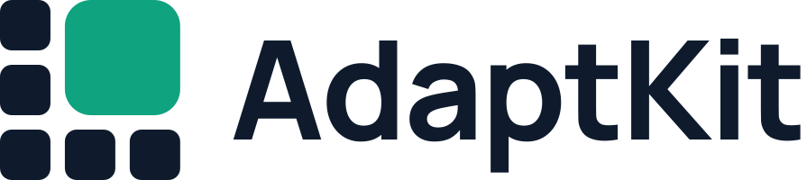
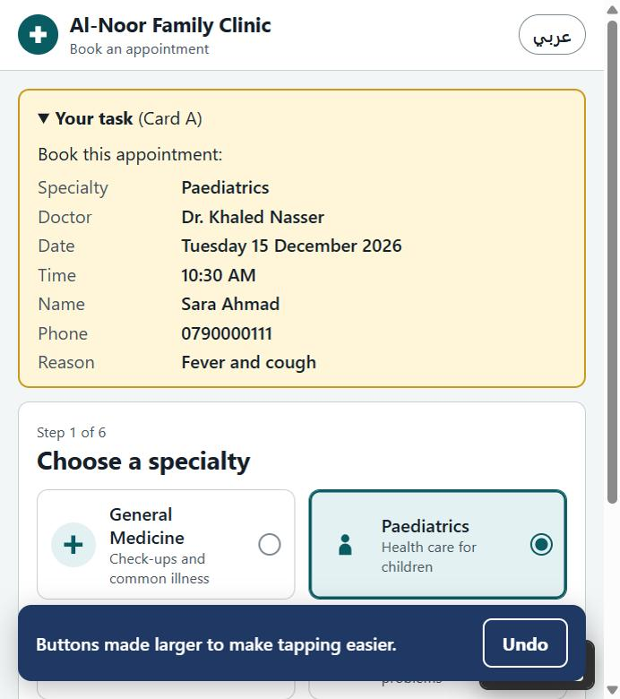
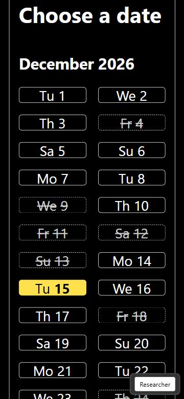

<p align="center">
  <picture>
    <source media="(prefers-color-scheme: dark)" srcset="brand/adaptkit-logo-dark.svg">
    
  </picture>
</p>

<p align="center"><strong>Interfaces that adapt to the person using them.</strong><br>
Bigger targets, bigger text, higher contrast or more spacing, chosen live by a small reinforcement-learning policy.</p>

<p align="center">
  <a href="LICENSE"></a>
  
  
  
</p>

---

Most interfaces look the same for everyone. People with shaky hands, weaker eyesight or less experience then miss buttons and slow down. **AdaptKit watches how someone actually uses your page** (missed presses, slow or uneven pointing) **and adapts it for them**, with a short notice and an **Undo** button every time.

```
watch presses → measure misses, speed, shakiness → need score → policy picks one change → safety rules check it → page adapts + notice with Undo
```

| Adaptation | Levels |
|---|---|
| Target size | 32 → 44 → 64 px (all above the WCAG 2.2 minimum of 24 px) |
| Text size | 100% → 150% → 200% |
| Contrast | normal ↔ high |
| Layout | compact ↔ spacious |

## Add it to your site in 3 steps

```html
<!-- 1. Load it -->
<link rel="stylesheet" href="https://cdn.jsdelivr.net/gh/jabbab-cs/adaptkit@v0.1.0/js/adaptkit.css">
<script type="module">
  import { AdaptKit } from 'https://cdn.jsdelivr.net/gh/jabbab-cs/adaptkit@v0.1.0/js/adaptkit.js';
  await AdaptKit.init({
    mode: 'adaptive',
    policy: 'https://cdn.jsdelivr.net/gh/jabbab-cs/adaptkit@v0.1.0/policies/default.json',
  });
</script>

<!-- 2. Mark what people press -->
<button data-adapt-target>Book</button>
```

```css
/* 3. Let your CSS follow the adaptations */
html { font-size: calc(16px * var(--ak-font-scale, 1)); }
[data-adapt-target] { min-width: var(--ak-target-min, 32px); min-height: var(--ak-target-min, 32px); }
[data-ak-contrast="high"] { /* your high-contrast theme */ }
[data-ak-layout="spacious"] .toolbar { gap: 1.5rem; }
```

Works with plain HTML and any framework: AdaptKit only listens to pointer events and sets CSS variables. Full guide: **[docs/integration.md](docs/integration.md)**.

## Try the demos

```
node serve.mjs
```

Then open <http://localhost:5173/examples/>:

- **Minimal**: nine buttons and the smallest working setup.
- **Clinic booking**: a bilingual (English/Arabic) booking app with static and adaptive modes, plus a researcher panel (`?researcher=1`) that runs study sessions and exports logs.

<p align="center">
  
  
</p>

## How it decides

- **Signals** (last 10 presses): miss rate, speed compared with a typical person (Fitts' law), how uneven the speed is, and a **need score** from a small logistic-regression model.
- **Policy**: a Q-table trained with **tabular Q-learning** on simulated users. Each simulated user is one real person's measured pointing behaviour from the Findlater & Zhang (2020) dataset of 735 people.
- **Safety shield**, the same in training and in the browser: no change during the first 5 presses, one change at a time, never outside the allowed levels, and never repeat a change the user undid.
- **Thinking pauses**: presses slower than 4× typical count as reading or deciding, not as slow movement.

The browser runtime and the Python trainer compute every signal identically. Shared test cases in [`spec/test_vectors.json`](spec/test_vectors.json) prove it.

## Included policies

| File | What it is |
|---|---|
| `policies/default.json` | The trained hybrid policy (Q-learning + need score + safety shield). Use this. |
| `policies/rl-only.json` | Q-learning without the need score (for comparison). |
| `policies/rule-based.json` | Hand-written rules (baseline). |
| `policies/demo.json` | The same rules, marked as a placeholder: easy to trigger on purpose for demos. |

**Simulated results** on 160 held-out simulated users built from real people the policy never saw during training:

| | Presses needing a retry | Time per press |
|---|---|---|
| Static (no adaptation) | 9.3% | 967 ms |
| Rule-based | 5.7% | 923 ms |
| **AdaptKit (default policy)** | **4.0%** | **900 ms** |

Gains are largest on touchscreens (16.4% → 5.2% retries). On mouse they are small, and the policy makes some changes that do not pay off. These are **simulation results, not measurements with real people**. Test with your own users before relying on them.

## Train your own

```
python -m pip install -r requirements.txt
python -I python/scripts/download_findlater.py
python -I python/scripts/build_layer_a.py
python -I python/scripts/train_need_model.py
python -I python/scripts/calibrate_simulator.py
python -I python/scripts/train_policy.py --split test --final
```

Change the levels, the reward weights or the assumptions to fit your interface. Details: **[docs/training.md](docs/training.md)**.

## Privacy

AdaptKit records **positions and timings only**, never what people type. Logs stay in the visitor's browser until you export them. Nothing is sent over the network.

## What's in the box

```
js/          adaptkit.js (the runtime, 0 dependencies) · adaptkit.css · tests
policies/    trained and baseline policy files
spec/        JSON schemas for events, profiles and policies · signal definitions · shared test cases
python/      the trainer: dataset converter, Fitts' law fits, need model, simulator, Q-learning
examples/    minimal page · clinic booking app with a researcher panel
docs/        integration and training guides
brand/       logo files
serve.mjs    a tiny local server for the examples
```

## Limits (v0.1)

- Keyboard-only use (Tab + Enter) is not recorded.
- The data contains no text-size or contrast changes, so those effects are modelled from stated assumptions. The trained policy mostly adapts target size.
- The touch + motor-impairment group in the data is small (30 sessions).

## Credits

Created by **Mohammad Jarrar** as part of a Computing Research Project at Al Hussein Technical University (Amman, Jordan).
Pointing data: Findlater, L. and Zhang, L. (2020) *Input Accessibility: A Large Dataset and Summary Analysis of Age, Motor Ability and Input Performance*, ASSETS 2020 ([dataset](https://github.com/leahkf/mouseandtouchinput), CC BY 4.0).

## Licence

[MIT](LICENSE)
