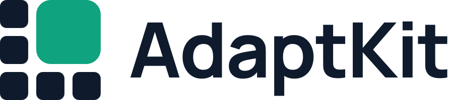

# AdaptKit brand

**The idea:** a kit grid where one piece has grown to fit the person using it. That is what AdaptKit does to an interface.

## Logo files

| File | Use it for |
|---|---|
| `adaptkit-logo.svg` | Main logo on light backgrounds |
| `adaptkit-logo-dark.svg` | Main logo on dark backgrounds |
| `adaptkit-logo-stacked.svg` | Square-ish spaces (posters, slides, profile pages) |
| `adaptkit-logo-black.svg` / `-white.svg` | One-colour printing, stamps, embroidery |
| `adaptkit-mark.svg` / `-dark.svg` | The symbol alone (avatars, small spaces) |
| `adaptkit-mark-small.svg` | **16–24 px only** (fewer tiles, wider gaps so it stays clear) |
| `adaptkit-wordmark.svg` | The name alone, when the symbol is already nearby |
| `icons/` | favicon.ico, favicon.svg, app icons, `site.webmanifest`, `head-snippet.html` |
| `social-preview.png` | 1280 × 640 card for the GitHub repository and link previews |

All files are built by `source/build_logo.py` from one geometry definition. Text is converted to outlines, so no font is needed to show them.

## Colours

| Name | HEX | RGB | Use |
|---|---|---|---|
| **Ink** | `#0F1B2D` | 15 27 45 | Small tiles, the wordmark, dark backgrounds |
| **Grow** | `#0FA37F` | 15 163 127 | The grown tile on light backgrounds; accents |
| **Grow Light** | `#34D5A6` | 52 213 166 | The grown tile on dark backgrounds |
| **Paper** | `#F7F7F2` | 247 247 242 | Light backgrounds |
| White | `#FFFFFF` | 255 255 255 | Small tiles and wordmark on dark backgrounds |

Contrast: Ink on white 17:1 · Grow on white 3.2:1 (graphics) · Grow Light on Ink 9.2:1. Use Grow for shapes and large text only. For small text on white, use Ink.

## Type

- **Logo and headlines:** Manrope, weight 760 (SIL Open Font License).
- **Body text:** the system UI font (`system-ui, "Segoe UI", sans-serif`), the same as in the kit's examples.

## Construction

- The mark is a 3 × 3 grid of 56 px tiles with 16 px gaps (200 px in total). The grown tile spans 2 × 2 cells (128 px).
- Corner radius: 13 px on small tiles, 29 px on the grown tile (the same proportion).
- In the horizontal logo, the cap height of "AdaptKit" is 55% of the mark's height, and the gap is one small tile (56 px).

## Clear space and sizes

- Keep clear space of **one small tile** (28% of the mark's height) on every side.
- Minimum sizes: horizontal logo 120 px wide · mark 24 px · below 24 px use `adaptkit-mark-small.svg`.

## Please don't

- Put the colour mark on a green background (the grown tile disappears), or the light-background version on dark (the navy tiles disappear). Use the dark or one-colour version instead.
- Recolour the tiles, add shadows or gradients, or rotate or stretch the logo.
- Retype the wordmark in another font.
- Change which tile has grown: the grown tile is always top-right, with the L-shape of small tiles around it.
